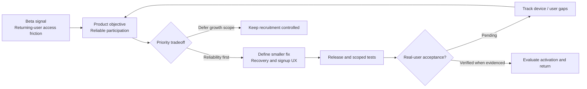

# GroupChat | From signal to delivery decision

**Artifact type:** Illustrative product-management flow · **Updated:** October 26, 2026 · **Case study:** v1.1

This visual illustrates my product decision and validation model. It is **not** a system architecture diagram and does not claim every user journey is accepted.

## Evidence ladder

| State | Meaning | GroupChat example |
| --- | --- | --- |
| Reported | User or tester describes a problem | Mobile zoom, recovery friction |
| Implemented | A change exists in working app source | Recovery guidance / signup UX changes |
| Deployed | Change is recorded in a hosted release | Recorded v62–v65 milestones |
| Automated tested | Targeted checks passed | v63 **79/79**; v65 **8/8** checks, both scoped |
| Accepted | Real tester/device verifies expected journey | **Not broadly established** for affected-user and cross-device paths |
| Outcome measured | Eligible cohort and time window yield a rate | **Not yet published** for signup, activation, or retention |

The distinction matters: **shipping a fix does not prove it solved the customer's problem**.

[Return to overview](README.md) · [See measurement definitions](MEASUREMENT_SCORECARD.md)
