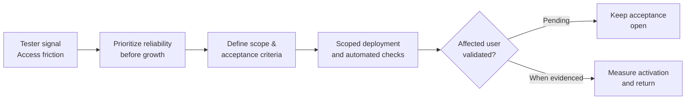

# T.F.B. | GroupChat — Product Management Case Study

**The Freeman Bureau (T.F.B.) product initiative | Mobile-first group conversations with a social feed | Private beta | Public case study v1.2 | Reviewed October 30, 2026**

[Professional portfolio](https://darrylearley.vercel.app/) · [Product decision and delivery evidence (PDF)](https://darrylearley.vercel.app/GroupChat_Product_Decision_and_Delivery_Evidence.pdf) · [LinkedIn](https://www.linkedin.com/in/darryl-earley-ii-3516981a6)

> **Disclosure:** This is a sanitized product-management case study, **not** deployable source code. The beta's operational records and application code remain private. My role includes product direction, requirements, UX decisions, prioritization, beta coordination and acceptance standards—not sole authorship of the application code.

## Product problem and experiment

GroupChat brings together the intimacy of group messaging and the discovery of a social feed, creating a connected space where conversations can grow into communities.

Useful photos, links, and updates can disappear in busy group chats. GroupChat explores whether group conversation and a browsable social feed can help people discover and revisit what their groups share.

**Current beta experience:** Group posts and replies, direct messages, images and links, GIFs, notifications, profiles, and bookmarks. The For You feed brings together pictures, links, and attached media from groups a member can access. This is group-scoped discovery, not an open network or a claim of algorithmic recommendations.

Invited participation centers on the shared Beta Testing group. Other sample groups are read-only demos. The installable web app remains in active private beta; native distribution and analytics instrumentation are future work.

**First success questions:** Can an invited user register and access the application? Can a registered member contribute a message, image, or link that another authorized member can see? Reliable participation takes priority over expansion.

[Reusable product messaging for users, recruiters, and investor-style conversations](PRODUCT_POSITIONING.md).

## Three representative product decisions

| Signal | Decision | Evidence / remaining work |
| --- | --- | --- |
| Returning users struggled with account access and recovery | Prioritize signup and recovery reliability before expanding recruitment | Scoped fixes released; affected-user validation remains open |
| Signup fields zoomed or clipped on iPhone | Separate a visual defect from authentication defects and define distinct acceptance tests | Automated checks documented; physical-device acceptance pending at review |
| Group conversations require consistent navigation and membership | Prioritize persistent membership and mobile navigation over nonessential enhancements | Targeted UI improvements; complete cross-device checks pending |

**Visual decision story:** [Follow the signal → tradeoff → scoped release → acceptance gate](PRODUCT_FLOW.md). · [Detailed product decisions](PRODUCT_DECISIONS.md).

## Product decision → customer outcome

**Why this matters:** Deployment and automated testing can be demonstrated; complete customer outcomes cannot yet be claimed.

## Evidence, not inflated claims

- Hosted beta release records extend through **v65** (October 2026). The public case study is not a verified source mirror.
- v63 recorded **79/79** scoped automated tests; v65 recorded **8/8** targeted checks. These do **not** imply complete user or device acceptance.
- The image below is a **sanitized reconstruction** of selected delivery statuses, **not an actual/live Jira board screenshot**.
- Full user A/B, returning-user, device and source-parity gates still require evidence.

## Measurement scorecard — as of October 26, 2026

| Evidence or outcome | Status |
| --- | --- |
| v63 automated checks | **79/79 passed**, scoped tests only |
| v65 targeted checks | **8/8 passed**, scoped tests only |
| Affected-user/device acceptance | **Pending at last review** |
| Signup conversion | **Not yet measured** |
| First-post activation | **Not yet measured** |
| Seven-day retention | **Not yet measured** |

**Not yet measured is not 0%.** [Open definitions, evidence requirements and measurement status](MEASUREMENT_SCORECARD.md).

## Two primary success measures

1. Invited users successfully register and access the application.
2. Registered users contribute messages, images, and links visible to authorized members.

Returning access and cross-user visibility are acceptance checks supporting these measures. Retention is later learning; no validated outcome rate is yet available.

These are **defined measurement goals**, not claimed performance percentages. [Acceptance and instrumentation plan](VALIDATION_PLAN.md).

## Product-management approach

As independent product owner, I manage direction, requirements, Jira priorities, beta feedback, acceptance criteria, and release decisions. I turn tester signals into scoped issues, clarify edge cases, direct AI-assisted development, review relevant build/test results, and record release scope and rollback references. Jira separates To Do, In Progress, In Review, and Done; user acceptance can remain open after a scoped change is deployed.

I use AI to accelerate analysis and implementation while retaining responsibility for product judgment and validation. I distinguish **implemented**, **deployed**, **tested**, **accepted** and **proven outcome**.

[Read limitations and privacy commitments](EVIDENCE_AND_LIMITATIONS.md). · [Governance and source-of-truth contract](GOVERNANCE.md) · [Change log](CHANGELOG.md).

**Darryl Earley II** · [Portfolio](https://darrylearley.vercel.app/) · [LinkedIn](https://www.linkedin.com/in/darryl-earley-ii-3516981a6)
